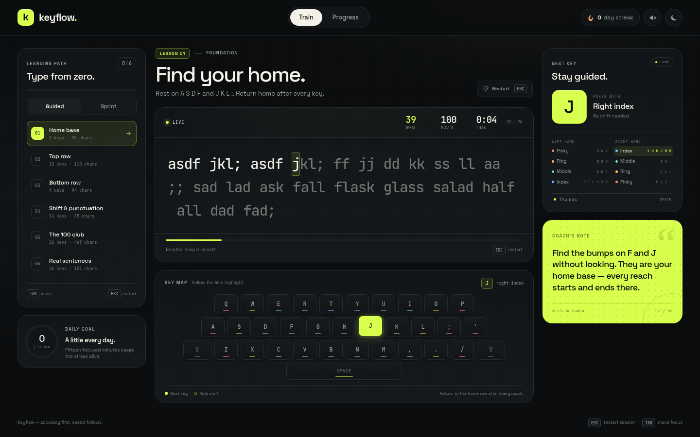

# Keyflow



**Live demo → <https://mansy0404-png.github.io/keyflow/>**

A small, focused typing trainer for learning touch typing and building speed. No frameworks, no build step, no account — just open it and type.

## Run it

The app is a static site. From this folder:

```bash
python3 -m http.server 8000 --bind 127.0.0.1
```

Then open **http://127.0.0.1:8000**.

You can also open `index.html` directly in a browser, though serving it locally is recommended for consistent font and storage behaviour.

### Deploy

The site is hosted for free on **GitHub Pages**, straight from the `main` branch:

1. Push to `main`.
2. Repository **Settings → Pages → Build and deployment → Source: Deploy from a branch**, then choose **`main` / `/ (root)`**.

Because every asset is linked relatively, the site works unchanged under the project subpath `/<repo>/`.

## What is inside

- **Six guided lessons** — home row, top row, bottom row, Shift and punctuation, the 100 most common words, and real sentences.
- **Live typing engine** — live WPM, accuracy, timer, character-level feedback, backspace correction, and automatic line scrolling.
- **Visual finger coach** — a colour-coded keyboard, next-key callout, Shift-hand guidance, and a per-finger map.
- **Sprint mode** — 15, 30, or 60 seconds of common words, auto-started on your first keystroke.
- **Progress page** — best speed, average accuracy, focus time, streaks, a recent-speed chart, lesson progress, and a 14-day streak calendar.
- **Personal bests** — only runs at **90% accuracy or higher** count toward best speed. Lessons need **85% accuracy** to pass.
- **Quality-of-life touches** — dark/light themes, optional keyboard clicks, mobile support, reduced-motion support, and local persistence.
- **Keyboard shortcuts** — `Esc` restarts the current session, `R` retries from the results screen.

Progress is stored in `localStorage` under `keyflow.v1`. Use **Progress → Reset data** to clear it.

## Structure

```
index.html          markup and views
css/styles.css      design system, responsive layout, animation
js/app.js           typing engine, lesson data, persistence, charts
assets/fonts/       local Space Grotesk + JetBrains Mono (SIL OFL)
```

Fonts are served locally so the site works offline. Space Grotesk and JetBrains Mono are licensed under the SIL Open Font License 1.1.
